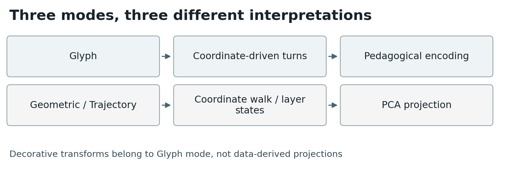
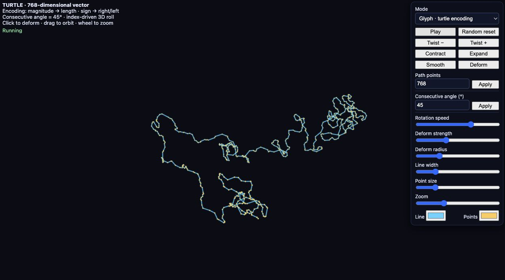
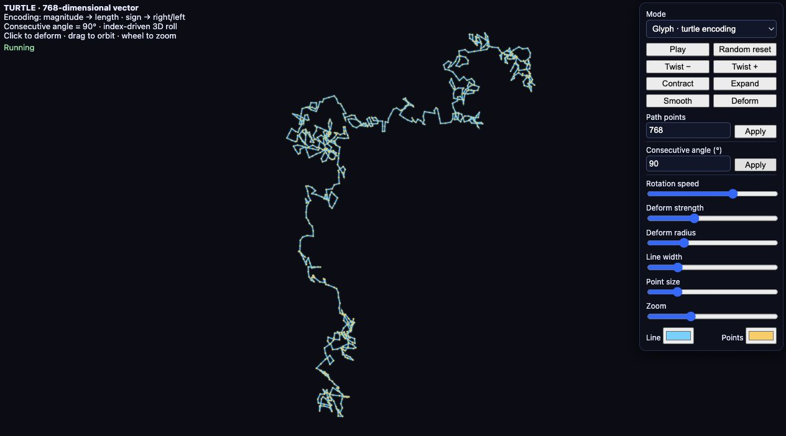

# TURTLE: Trajectory-based Understanding and Rendering of Transformations in Latent Embeddings

William Taggart  
Modern and Classical Languages and Literatures, Virginia Tech  
wtaggart@vt.edu

Report date: November 14, 2026

## Abstract

Large language models represent tokens and contextual states in high-dimensional vector spaces that are difficult to inspect directly. This report presents TURTLE (Trajectory-based Understanding and Rendering of Transformations in Latent Embeddings), a framework that adapts ideas from turtle geometry to the visualization of vector embeddings and layerwise representation trajectories. TURTLE distinguishes three complementary modes. Glyph mode converts the coordinates of a vector into a three-dimensional turtle signature for pedagogical visualization. Geometric mode constructs a literal coordinate-wise walk in the original n-dimensional space and projects that walk into three dimensions using principal component analysis (PCA). Trajectory mode accepts actual model states, allowing a token's contextual representation to be followed across successive transformer layers. The current open-source implementation includes a reproducible BERT-base demonstration comparing the hidden-state trajectory of the word 'jaguar' in animal and automobile contexts. The two trajectories are projected through a shared PCA basis, placing them in the same three-dimensional coordinate system and allowing their projected relative positions to be compared. TURTLE therefore provides both an explanatory metaphor and an experimental visualization method for studying change in high-dimensional neural representations. Its principal limitations arise from dimensionality reduction, basis dependence in coordinate walks, and the risk of over-interpreting visual similarity.

## Purpose and Research Context

TURTLE, Trajectory-based Understanding and Rendering of Transformations in Latent Embeddings, makes high-dimensional neural representations inspectable as paths. Language models encode tokens and contextual states in vectors that are computationally accessible but difficult to visualize directly. Rather than concentrating only on where a representation lies in a projected space, the framework asks how a path can express its coordinates or its movement through successive stages of computation.

Turtle geometry supplies the movement-centered foundation. In the MIT Logo tradition formalized by Abelson and diSessa, an agent reasons about geometry by changing position and orientation through local commands ([Abelson et al., 1981](#ref-abelson)). Subsequent work extends this approach to computer graphics, computer-aided design, and three-dimensional settings, while Hanson's N-dimensional graphics supplies methods for higher-dimensional geometry and rotation ([Goldman et al., 2004](https://doi.org/10.1016/j.cad.2003.10.005); [Hanson, 1994](https://doi.org/10.1016/B978-0-12-336156-1.50024-0); [Hanson, 1995](#ref-hanson1995); [Verhoeff, 2010](https://doi.org/10.1504/IJART.2010.032569)). TURTLE adapts that perspective to embeddings and contextual hidden states: a vector can define a destination or coordinate walk, a difference can define a displacement, and an ordered series of states can define a trajectory.

Projection then becomes an explicit part of the interpretation. The implementation uses a shared PCA basis to compare paths; UMAP offers a nonlinear, neighborhood-based research comparison rather than an implemented rendering mode ([McInnes et al., 2018](https://arxiv.org/abs/1802.03426)). Assessing projection stability and neighborhood preservation can help determine which visual relationships are robust, but neither projection independently validates semantic similarity. The framework therefore distinguishes a pedagogical encoding of a vector from a geometric coordinate walk and from a trajectory of actual model states.

This report describes the working open-source implementation and a proof-of-concept experiment with real BERT hidden states. Throughout, latent representations refers collectively to embedding vectors and contextual states, with the distinction specified where it affects the computation. The scope is an inspectable visualization method and explanatory framework; claims about meaning or model behavior require evidence beyond the resemblance of projected paths.

## Mathematical Foundation

Let an embedding or hidden representation be a vector v in $\mathbb{R}^n$. A turtle position at step t is represented by $p_t$ in $\mathbb{R}^n$, and a displacement by $\Delta p_t$. The generic movement rule is

$$p_{t+1}=p_t+\Delta p_t.$$

This rule is independent of dimensionality. The same operation applies in two dimensions, three dimensions, or a latent space with hundreds or thousands of coordinates. The central challenge is therefore not whether turtle motion can be defined in n dimensions, but how the motion should be constructed and how it should be rendered for human inspection.

TURTLE separates these questions. The computational trajectory may remain in the original n-dimensional space, while a projection function P maps its points into $\mathbb{R}^3$ for display:

$$P:\mathbb{R}^n\to\mathbb{R}^3.$$

The current implementation uses PCA, computed through singular-value decomposition of centered trajectory points. PCA constructs orthogonal components that successively maximize variance, providing a standard linear method for reducing dimensionality while retaining as much variance as possible in the chosen number of components [7](#ref-jolliffe). The visible path should therefore be understood as a three-dimensional shadow of a higher-dimensional trajectory, not as the trajectory itself.



*Figure 1. Mode taxonomy. Glyphs encode a vector, geometric mode projects a coordinate-wise walk, and trajectory mode projects ordered model states. The modes should not be interpreted interchangeably.*

## TURTLE Modes

The current implementation deliberately distinguishes three modes so that artistic encoding, geometric projection, and model-state analysis are not conflated.



*Figure 2. Glyph mode turns the displayed 768-dimensional vector into a three-dimensional turtle path using a 45-degree consecutive angle.*
### Glyph mode: turtle encoding

Glyph mode retains the original pedagogical prototype. For each scalar coordinate $v_i$, the magnitude $|v_i|$ determines segment length, the sign determines a right or left turn, and a fixed turning angle separates consecutive segments. An index-driven roll changes the local turning plane so that the generated trace develops three-dimensional structure. The mapping can be written schematically as

$$v\in\mathbb{R}^n\mapsto G(v)\in\{\text{3D polygonal paths}\}.$$

This mode creates a distinctive turtle signature from a vector, but it is an encoding rather than a projection of the vector's native geometry. Some visible structure, especially depth, is introduced by the encoding algorithm. For that reason, TURTLE labels this mode as Encoding and permits decorative operations such as twisting, smoothing, expansion, and interactive deformation only here.

### Geometric mode: literal n-dimensional coordinate walk

Geometric mode implements a literal coordinate-wise decomposition of the vector as a walk through the original n-dimensional coordinate space. Given $v=(v_1,\ldots,v_n)$, TURTLE begins at the origin and reveals one coordinate at a time:

$$p_0=0,\qquad p_i=\sum_{j=1}^{i}v_j e_j,\qquad i=1,\ldots,n.$$

where $e_j$ is the jth standard basis vector. Thus $p_n = v$: the final turtle position is the actual input vector. The complete sequence of $n+1$ points is then centered and projected to three principal-component score dimensions. No artificial turn, roll, or deformation is applied in this mode. Segment color can preserve the sign of the source coordinate, and interactive inspection reports the original dimension and value associated with a displayed segment.

This construction provides a mathematically literal n-dimensional walk, but the path itself depends on coordinate order. Permuting the dimensions changes the intermediate trajectory even though many geometric relationships among complete vectors may remain unchanged. Accordingly, geometric mode is best understood as a canonical coordinate decomposition for explanation and inspection rather than as an invariant characterization of an embedding.

### Trajectory mode: actual model states

Trajectory mode avoids the arbitrary coordinate-ordering problem of Geometric mode by using a naturally ordered sequence of representations. Let $h^{(0)},h^{(1)},\ldots,h^{(L)}$ denote the hidden state of a target token at successive stages of a transformer. TURTLE treats these states directly as turtle positions:

$$h^{(0)}\to h^{(1)}\to\cdots\to h^{(L)}.$$

The displacement between successive layers is

$$\Delta h^{(l)}=h^{(l+1)}-h^{(l)}.$$

Here the order is intrinsic to the computation: layer l precedes layer $l+1$. Prior work has shown that contextual representations change substantially across contexts and layers, and has found evidence that different kinds of linguistic information are distributed differently across BERT's depth [3](#ref-ethayarajh); [8](#ref-tenney). TURTLE provides a direct geometric visualization of such layerwise change rather than reducing each state to an isolated point without an explicit path.

## Proof-of-Concept: Contextual Trajectories in BERT

The current repository contains a reproducible demonstration built from `google-bert/bert-base-uncased`, the 12-layer, 768-hidden-dimension BERT-base model described by [2](#ref-devlin). TURTLE extracts the representation of the word 'jaguar' in two sentences: 'The jaguar rested quietly in the jungle.' and 'The Jaguar accelerated quickly out of the garage.' The first context selects the animal sense, while the second selects the automobile sense.

The extraction script requests hidden states from the model and gathers the target word's representation from the embedding output and each of the 12 transformer blocks, producing a $13\times768$ matrix for each sentence. If a target word occupies multiple subword tokens, the implementation mean-pools the corresponding subword-token representations at each layer. The resulting matrices and provenance metadata are stored with the project so that the demonstration can be reproduced.

For comparative visualization, TURTLE does not fit PCA separately to the two contextual trajectories. Instead, the $13\times768$ matrices are concatenated, a single PCA basis is fit to the combined set, and the projected points are then separated back into two paths. This shared basis is essential: two independent PCA solutions would have unrelated axes, making visual comparisons of orientation or relative position potentially misleading. In the shared projection, both paths inhabit the same three-dimensional coordinate system.

The displayed comparison consists of two ordered paths, one for each sentence. Consecutive points follow the embedding output and transformer-layer outputs, so the connecting lines encode computational order rather than a continuous motion observed inside the model. Their relative positions are meaningful only within the shared projection and remain subject to the information loss introduced by PCA.

The demonstration should not be interpreted as evidence that three dimensions recover the full geometry of BERT's 768-dimensional hidden states. Its purpose is narrower: to show that TURTLE can accept genuine model representations, preserve their computational ordering, and render their transformations as an inspectable path. The most important object remains the original high-dimensional trajectory; the three-dimensional view is an interface to it.

## Implementation

The open-source implementation is written primarily in Python with an embedded browser-based visualization layer. The repository currently provides `TURTLE.py`, a BERT extraction utility, reproducibility metadata and hidden-state data, dependency files, and a standalone GitHub Pages build. The software supports local Python execution as well as notebook environments.



*Figure 3. Glyph mode after changing the consecutive angle to 90 degrees, illustrating how the same encoding controls alter the displayed path.*
Three functions capture the core scientific operations. `embedding_to_nd_walk` constructs the coordinate-wise n-dimensional path whose endpoint is the original vector. `representation_trajectory_to_3d` projects an arbitrary matrix of successive model states into three PCA dimensions. `project_trajectories_shared` concatenates multiple trajectories before projection so that comparative paths use the same PCA basis. These functions separate the underlying geometric operations from the interactive display layer.

The implementation also enforces an interpretive boundary in the interface. Decorative transformations are disabled for data-derived geometric projections and model trajectories, while they remain available in glyph mode. This design choice reduces the risk that a user will mistake a manually altered curve for a projection of the source representation.

### Algorithm 1. Coordinate-walk projection

```text
Input: vector v in R^n
p_0 <- 0
for i = 1,...,n:
    p_i <- p_(i-1) + v_i e_i
center {p_0,...,p_n}
fit PCA and retain three components
return projected path P(p_0),...,P(p_n)
```

### Algorithm 2. Shared projection of model trajectories

```text
Input: trajectories H_1,...,H_m, each with hidden width n
concatenate all trajectory states along the observation axis
fit one PCA basis to the combined matrix
project all states into the shared three-dimensional basis
split the projected matrix back into H_1,...,H_m paths
return comparable 3D trajectories
```

## Potential Research Applications

TURTLE can be extended beyond the BERT homonym demonstration in several directions. First, layerwise trajectories can be compared for ambiguous words across contexts to study when representational paths diverge. Second, multilingual models could be used to compare translations or semantically aligned expressions across languages, provided that comparisons are performed within a shared representation space and with a shared projection basis. Third, prompt or sentence perturbations could be treated as controlled changes and their resulting trajectories compared quantitatively in the original space and visually in projection.

The framework is also compatible with richer measurements than simple visual inspection. At each step, one can calculate Euclidean displacement, cosine similarity, path length, turning angles in the full space, or distances between paired trajectories. The visualization can then be treated as a companion to quantitative analysis rather than as a substitute for it. This is particularly important because contextual representation spaces are anisotropic and because low-dimensional projections can distort distances and neighborhoods [3](#ref-ethayarajh).

A further application is pedagogical. Conventional diagrams often present embeddings as static dots in a semantic map. TURTLE instead foregrounds movement: representations occupy positions, transformations create displacements, and sequences of transformations create trajectories. This can provide an intuitive bridge from elementary vector arithmetic to the layerwise dynamics of transformer models.

## Limitations and Scientific Cautions

Several limitations should be stated explicitly. First, glyph mode is a deterministic encoding of vector coordinates into a three-dimensional curve, not a faithful projection of the original geometry. Similar-looking glyphs should not be assumed to imply similar embeddings without empirical validation.

Second, geometric mode is basis- and order-dependent. The coordinate walk follows the stored dimension order but embedding dimensions generally do not have an intrinsic semantic sequence. Its endpoint is the original vector, but its intermediate path is a chosen decomposition.

Third, PCA is lossy. A three-dimensional projection omits variance present in the original n-dimensional states, and visual distances or intersections can be artifacts of projection. Quantitative claims should therefore be calculated in the original representation space whenever possible. TURTLE visualizations are best used for hypothesis generation, explanation, and qualitative comparison unless accompanied by high-dimensional measurements.

Fourth, a hidden state is not a directly interpretable semantic coordinate system. Individual dimensions generally should not be assigned simple human-readable meanings. A trajectory indicates representational change, but the psychological or linguistic interpretation of that change requires additional evidence.

Finally, the present BERT demonstration is intentionally small. It establishes feasibility rather than statistical generality. Systematic evaluation should include larger sets of lexical items, contexts, models, layers, languages, and projection methods, together with tests of trajectory stability under alternative preprocessing and dimensionality-reduction choices.

## Discussion and Conclusion

TURTLE brings together three lines of work that are usually discussed separately: turtle geometry as movement-centered mathematical reasoning, N-dimensional graphics as a formal framework for high-dimensional geometry, and neural representation analysis as the study of high-dimensional contextual states. The novelty of the framework lies not in claiming a new algebra for vector spaces, but in organizing these established ideas into a trajectory-centered visualization method for language-model representations.

The current implementation materially strengthens the proposal. TURTLE now demonstrates three levels of representation: an explicitly pedagogical glyph encoding, a literal coordinate-wise walk in $\mathbb{R}^n$ followed by PCA, and a research-oriented trajectory mode based on actual hidden states. The BERT 'jaguar' example shows that successive model states can be extracted, jointly projected, and displayed as comparable paths through a shared lower-dimensional space.

The most promising direction is the third mode. When successive turtle positions are actual transformer states, the path connects representations produced at successive stages of the model's computation. TURTLE therefore shifts the visual question from 'Where is this embedding?' to 'How does this representation move as the model transforms it?' That change in perspective may prove useful both for teaching high-dimensional representation geometry and for exploratory analysis of language-model internals.

## Code and Reproducibility

The current TURTLE implementation, demonstration data, extraction script, dependency files, and standalone visualization are publicly available in the FL2744/TURTLE GitHub repository: https://github.com/FL2744/TURTLE.

## AI-use disclosure

The original report records implementation assistance from OpenAI Codex and GPT-5.6. This report was prepared with assistance from Codex. William Taggart is responsible for the final text and its claims. AI assistance does not constitute independent validation of the implementation or scientific interpretation.

## References

<a id="ref-abelson"></a>

1. H. Abelson and A. A. diSessa. 1981. *Turtle Geometry: The Computer as a Medium for Exploring Mathematics*. MIT Press. 

<a id="ref-devlin"></a>

2. J. Devlin and M.-W. Chang and K. Lee and K. Toutanova. 2019. *BERT: Pre-training of Deep Bidirectional Transformers for Language Understanding*. NAACL-HLT, 4171–4186. [https://doi.org/10.18653/v1/N19-1423](https://doi.org/10.18653/v1/N19-1423).

<a id="ref-ethayarajh"></a>

3. K. Ethayarajh. 2019. *How Contextual Are Contextualized Word Representations? Comparing the Geometry of BERT, ELMo, and GPT-2 Embeddings*. EMNLP-IJCNLP, 55–65. [https://doi.org/10.18653/v1/D19-1006](https://doi.org/10.18653/v1/D19-1006).

<a id="ref-goldman"></a>

4. R. Goldman and S. Schaefer and T. Ju. 2004. *Turtle Geometry in Computer Graphics and Computer-Aided Design*. Computer-Aided Design 36(14), 1471–1482. [https://doi.org/10.1016/j.cad.2003.10.005](https://doi.org/10.1016/j.cad.2003.10.005).

<a id="ref-hanson1994"></a>

5. A. J. Hanson. 1994. *Geometry for N-dimensional Graphics*. In Graphics Gems IV, P. S. Heckbert (Ed.). Academic Press. [https://doi.org/10.1016/B978-0-12-336156-1.50024-0](https://doi.org/10.1016/B978-0-12-336156-1.50024-0).

<a id="ref-hanson1995"></a>

6. A. J. Hanson. 1995. *Rotations for N-dimensional Graphics*. In Graphics Gems V, A. W. Paeth (Ed.). Academic Press. 

<a id="ref-jolliffe"></a>

7. I. T. Jolliffe and J. Cadima. 2016. *Principal Component Analysis: A Review and Recent Developments*. Philosophical Transactions of the Royal Society A 374(2065), 20150202. [https://doi.org/10.1098/rsta.2015.0202](https://doi.org/10.1098/rsta.2015.0202).

<a id="ref-tenney"></a>

8. I. Tenney and D. Das and E. Pavlick. 2019. *BERT Rediscovers the Classical NLP Pipeline*. ACL, 4593–4601. [https://doi.org/10.18653/v1/P19-1452](https://doi.org/10.18653/v1/P19-1452).

<a id="ref-verhoeff"></a>

9. T. Verhoeff. 2010. *3D Turtle Geometry: Artwork, Theory, Program Equivalence and Symmetry*. International Journal of Arts and Technology 3(2–3), 288–319. [https://doi.org/10.1504/IJART.2010.032569](https://doi.org/10.1504/IJART.2010.032569).

<a id="ref-taggart"></a>

10. William Taggart. 2026. *TURTLE: Trajectory-based Understanding and Rendering of Transformations in Latent Embeddings*. Computer software. GitHub. [https://github.com/FL2744/TURTLE](https://github.com/FL2744/TURTLE).
11. McInnes, Leland, Healy, John, Melville, James (2018). [UMAP: Uniform Manifold Approximation and Projection for Dimension Reduction](https://arxiv.org/abs/1802.03426). DOI: 10.48550/arXiv.1802.03426.

## Suggested citation

William Taggart. 2026. TURTLE: Trajectory-based Understanding and Rendering of Transformations in Latent Embeddings. Technical report. Modern and Classical Languages and Literatures, Virginia Tech. November 14, 2026. https://github.com/FL2744/TURTLE
